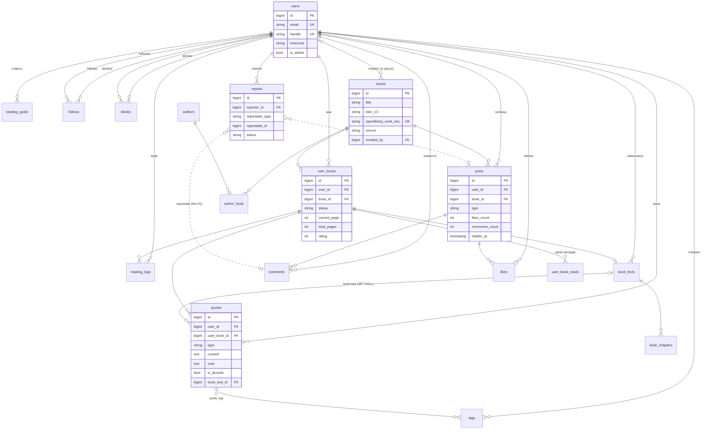

# Bookshelf: модель даних

Складено за міграціями в `backend/database/migrations`. База: MySQL 8.4, `utf8mb4`. Принцип: **книга в каталозі спільна
для всіх, а особисті дані (статус, прогрес, цитати, текст) належать читачу**. Пост спільноти посилається на книгу
каталогу, а не на приватний запис бібліотеки.

## ER-діаграма

## Таблиці

### Користувачі і служби

| Таблиця | Ключові колонки | Примітки |
|---|---|---|
| `users` | `id`, `name`, `email` (unique), `password` (hash), `timezone` (за замовч. `Europe/Kyiv`), `handle` (unique, 3-30 символів `a-z0-9_`), `bio` (до 280), `is_admin` | `handle` перевіряється `CHECK` з урахуванням регістру. `is_admin` це технічний прапорець модератора |
| `password_reset_tokens` | `email` (PK), `token`, `created_at` | службова (Laravel) |
| `sessions` | `id` (PK), `user_id`, `payload`, `last_activity` | сесії зберігаються в базі; без FK |
| `cache`, `cache_locks`, `jobs`, `job_batches`, `failed_jobs` | | службові таблиці Laravel (кеш, черга) |

### Каталог

| Таблиця | Ключові колонки | Примітки |
|---|---|---|
| `authors` | `id`, `name`, `openlibrary_key` (unique) | |
| `books` | `id`, `title`, `subtitle`, `isbn_13`, `openlibrary_work_key` (unique), `cover_url` (до 2048), `page_count`, `published_year`, `subjects` (JSON), `source` (`openlibrary` / `manual`), `created_by` → `users` | книги з `source = manual` бачить лише автор (`created_by`) |
| `author_book` | PK (`book_id`, `author_id`), `position` | зв'язок книги й авторів, `position` задає порядок |

### Бібліотека читача

| Таблиця | Ключові колонки | Примітки |
|---|---|---|
| `user_books` | `id`, `user_id`, `book_id` (пара unique), `status` (`want`/`reading`/`finished`/`abandoned`), `current_page`, `total_pages`, `rating` (1-5), `started_at`, `finished_at` | `total_pages` це копія сторінок книги, яку читач може виправити під своє видання. `CHECK`: `rating` 1-5, `current_page <= total_pages` |
| `user_book_reads` | `id`, `user_book_id`, `started_at`, `finished_at` | архів минулих проходів (перечитування, імпорт Goodreads) |
| `reading_logs` | `id`, `user_book_id`, `user_id`, `from_page`, `to_page`, `logged_on` (дата в часовому поясі читача), `created_at` | запис про кожну зміну сторінки; `CHECK from_page <> to_page`. `user_id` повторено, щоб статистика не робила join |
| `reading_goals` | `id`, `user_id`, `year`, `target_books` (1-1000) | пара (`user_id`, `year`) unique |

### Цитати й теги

| Таблиця | Ключові колонки | Примітки |
|---|---|---|
| `quotes` | `id`, `user_book_id`, `user_id`, `type` (`quote`/`insight`), `content`, `note`, `page`, `is_favorite`; прив'язка до тексту: `book_text_id`, `chapter_position`, `start_offset`, `end_offset` | усі чотири поля прив'язки заповнені або порожні (`CHECK` на три, четверте тримає застосунок). Зсуви в кодових одиницях UTF-16. FULLTEXT-індекс `quotes_content_note_fulltext (content, note)` з парсером `ngram` для пошуку (працює для кирилиці) |
| `tags` | `id`, `user_id`, `name` (до 40) | пара (`user_id`, `name`) unique; назва нормалізується (нижній регістр, без зайвих пробілів). Теги приватні |
| `quote_tag` | PK (`quote_id`, `tag_id`) | до 10 тегів на цитату (рахує застосунок) |

### Читанка

| Таблиця | Ключові колонки | Примітки |
|---|---|---|
| `book_texts` | `id`, `user_book_id` (unique), `user_id`, `source_name`, `chapters_count`, `characters_count`, `chapter_position`, `chapter_progress`, `progress` (0-1), `position_updated_at` | один текст на запис бібліотеки. Оригінальний EPUB не зберігається |
| `book_chapters` | `id`, `book_text_id`, `position` (з 0), `title`, `content` (очищений HTML, `LONGTEXT`), `characters` | пара (`book_text_id`, `position`) unique |

### Спільнота

| Таблиця | Ключові колонки | Примітки |
|---|---|---|
| `posts` | `id`, `user_id`, `book_id`, `type` (`quote`/`review`), `content`, `comment`, `rating`, `page`, `likes_count`, `comments_count`, `hidden_at` | знімок тексту (не посилається на цитату). `CHECK`: відгук має оцінку 1-5, цитата не має оцінки й має `content`. Віртуальна колонка `review_book_id` + unique (`user_id`, `review_book_id`) гарантує **один відгук на книгу**, а цитат може бути багато. Лічильники веде застосунок у транзакціях |
| `follows` | PK (`follower_id`, `followed_id`), `created_at` | `CHECK` не на себе |
| `likes` | PK (`user_id`, `post_id`), `created_at` | один лайк на пост |
| `comments` | `id`, `post_id`, `user_id`, `content` (до 1000), `hidden_at` | плоский список |
| `blocks` | PK (`user_id`, `blocked_id`), `created_at` | `CHECK` не на себе |
| `reports` | `id`, `reporter_id`, `reportable_type` (`post`/`comment`), `reportable_id`, `reason` (`spam`/`abuse`/`other`), `note`, `status` (`open`/`resolved`) | унікальна (`reporter_id`, `reportable_type`, `reportable_id`): одна скарга від читача на об'єкт, тож «3 скарги» це 3 різні читачі. **Без FK**, бо вказує на дві таблиці (morph map `post`, `comment`) |

## Каскади і правила цілісності

Зовнішні ключі з `ON DELETE CASCADE`, якщо не сказано іншого.

- **Видалення акаунта** (`DeleteAccount`, у транзакції): каскадом зникають бібліотека, журнал, цитати, цілі, теги,
  тексти, пости (з лайками й коментарями під ними), коментарі, лайки, підписки, блокування, скарги, подані читачем.
  Каскад не покриває три речі, їх робить застосунок: **перераховує `likes_count` і `comments_count`** у чужих постів,
  де були лайки чи коментарі цього читача; видаляє **скарги на його пости й коментарі** (у `reports` немає FK);
  видаляє його **сесії та токени скидання пароля** (без FK). Ручні книги читача лишаються без автора
  (`books.created_by` = `SET NULL`), доки їх хтось тримає або під ними є пости.
- **Видалення книги з бібліотеки** (`user_books`): зникають журнал, цитати, архів проходів і завантажений текст з
  розділами. **Пости про книгу лишаються**, бо посилаються на `books`. Книга, додана вручну, видаляється з каталогу
  лише якщо її більше ніхто не тримає **і** під нею немає постів. Інакше вона лишається в каталозі (назва видна в постах).
- **Видалення тексту книги** (`book_texts`): розділи зникають каскадом. У цитат `book_text_id` стає `NULL`
  (`ON DELETE SET NULL`), а три інші поля прив'язки обнуляє застосунок (MySQL не дозволяє `CHECK` на колонці з
  `SET NULL`). **Цитати лишаються.** Заміна тексту скидає прив'язки так само.
- **Видалення поста** (`DeletePost`): зникають лайки й коментарі (каскад) і скарги на пост та його коментарі
  (робить застосунок). **Цитата, з якої зроблено пост, не чіпається.**
- **Видалення цитати** не впливає на пост (він знімок).
- **Видалення тегу чи цитати** прибирає рядки `quote_tag`.
- **Приховування** (`hidden_at`) не видаляє нічого: прихований пост і коментар бачить лише автор. Приховування
  коментаря зменшує `comments_count` поста, відновлення збільшує.
- **Блокування** видаляє підписки між двома читачами в обидва боки; самі блоки не впливають на дані постів.

## Перевірки на рівні бази

Щоб помилка в коді не могла записати неможливий стан, критичні правила задані `CHECK`-обмеженнями: формат `handle`,
діапазон `rating` і `target_books`, `current_page <= total_pages`, `from_page <> to_page`, відомі значення `type`,
`reason`, `status`, узгодженість `rating` і `type` посту, неможливість підписатися чи заблокувати себе, цілісність
прив'язки цитати (`start_offset < end_offset`, поля або всі, або жодне), діапазон прогресу `book_texts` (0-1).
