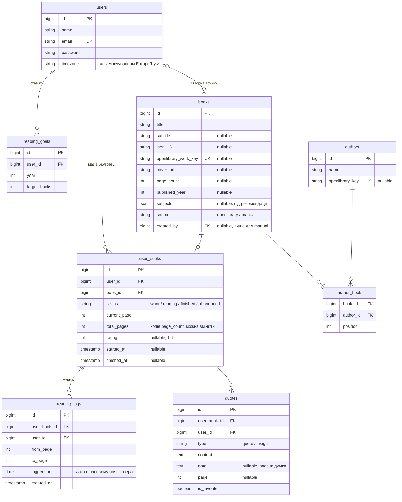

# Bookshelf — бачення і план MVP

> Живий документ: змінюємо, коли змінюються рішення.

## 1. Бачення

Мінімалістичний трекер особистої бібліотеки для телефона. Книгу додаєш за 10 секунд, сторінку оновлюєш за 2, цитату зберігаєш одним дотиком і бачиш, як просувається читання. Без стрічок, лайків і шуму. Під капотом при цьому нормальна інженерія: API-first, тести, CI, Docker, деплой.

## 2. Обсяг MVP

### Входить

- Реєстрація і вхід (email + пароль), ізоляція даних між користувачами
- Бібліотека: книга з Open Library або вручну; статуси «хочу» / «читаю» / «прочитано» / «відкладено»; оцінка 1–5
- Прогрес: швидке оновлення поточної сторінки, прогрес-бари, журнал читання
- Цитати та інсайти з прив'язкою до книги й сторінки, улюблені, картинка-картка для поширення
- Статистика: сторінки по днях, серія днів поспіль, темп, прогноз завершення книги
- Річна ціль «N книг за рік» з індикатором «встигаю / відстаю»
- PWA: встановлюється на телефон, кешує оболонку застосунку
- Тести, CI, Docker, деплой

### Definition of Done

Користувач з телефона реєструється, знаходить книгу в Open Library (або вносить вручну), веде прогрес, зберігає цитати й ділиться карткою, бачить статистику і річну ціль. Застосунок встановлюється як PWA, задеплоєний, CI зелений.

### Не входить (backlog після MVP)

Найближчі невеликі фічі:

- Сканер ISBN камерою
- Офлайн-оновлення прогресу з подальшою синхронізацією
- Повнотекстовий пошук (FULLTEXT-індекс MySQL) і теги для цитат
- Експорт цитат у Markdown
- Вхід через Google
- Перечитування (кілька проходів однієї книги)

Великі напрями:

- **Соцмережа**: публічні профілі, спільні цитати, відгуки, стрічка друзів
- **AI-рекомендації**: на основі оцінок, жанрів і цитат користувача
- **Читанка**: завантаження EPUB і читання в застосунку. Прогрес там рахується за позицією в тексті, а не за сторінками, тож це окремий модуль

Що вже в MVP заклали під ці напрями:

- API-first: соцфічі чи нативний застосунок підключаються до того самого API
- `books` — спільний каталог, тож «хто ще читає цю книгу» і рекомендації будуються поверх нього
- `books.subjects` (жанри/теми з Open Library) зберігаємо вже зараз: це вхідні дані для рекомендацій
- Цитати мають власника і книгу, тож поле `visibility` для соцмережі додається однією міграцією

## 3. Архітектура і стек

```
Телефон / браузер ──► nginx ──┬── /       → Vue SPA (статика, PWA)
                              └── /api/*  → Laravel (php-fpm) ──► MySQL
                                                  │
                                                  └──► Open Library API (з кешем)
```

| Шар | Вибір | Чому |
|---|---|---|
| Бекенд | Laravel (актуальна стабільна), PHP 8.4 | вимога команди |
| API | REST JSON: API Resources, Form Requests | чіткий контракт між фронтом і беком |
| Документація API | Scramble (OpenAPI генерується з коду) | контракт без ручного написання; згодиться для лаб |
| Автентифікація | Sanctum (SPA, cookie + CSRF) + Fortify (headless) | безпечніше за токени в localStorage; Fortify дає реєстрацію, вхід, скидання пароля. Сесія довга, щоб PWA не просила вхід щоразу |
| БД | MySQL 8.4 LTS, `utf8mb4` / `utf8mb4_0900_ai_ci` | команді знайоміший; JSON-колонки і FULLTEXT-індекс на майбутнє; `CHECK`-обмеження працюють з 8.0.16 |
| Фронт | Vue 3 + TypeScript + Vite | команда знає Vue; добре стикується з Laravel |
| Стан | Pinia (сесія, бібліотека, UI) | оптимістичні оновлення прогресу з чергою запитів зроблені в сторі без зайвої залежності. TanStack Query свідомо не підключали; повернемось до цього, якщо офлайн-режим (етап 5) покаже, що кеш потрібен |
| Стилі | Tailwind CSS | швидко, mobile-first |
| PWA | власний Service Worker (~100 рядків) і маніфест, без бібліотек | оболонка застосунку кешується, дані читача ніколи; vite-plugin-pwa/Workbox не потрібні, а власну логіку повністю покривають тести (див. `docs/pwa.md`) |
| Графіки | власний SVG-компонент | одна стовпчаста діаграма сторінок по днях не виправдовує залежності на ~60 КБ (Chart.js ми спершу планували); менший бандл і кеш PWA |
| Картка цитати | html-to-image + Web Share API | PNG генерується на клієнті, на телефоні відкривається нативне «Поділитися» |
| i18n | vue-i18n (інтерфейс українською) | англійську можна додати без переписування |
| Типи API | openapi-typescript (з OpenAPI від Scramble) | зміни контракту фронт ловить уже при компіляції |
| Тести | Pest (бек), Vitest (фронт) | Playwright для E2E — після MVP |
| Якість коду | Pint, Larastan; ESLint, vue-tsc | — |
| Інфраструктура | Docker Compose, GitHub Actions | CI на кожен PR, CD з `main` |

### Чому окремі SPA + API, а не Inertia

- PWA і офлайн природніше лягають на SPA, яка бере дані з API
- Соцмережа, читанка, можливий нативний застосунок стануть новими клієнтами того самого API
- Бек і фронт працюють паралельно за контрактом OpenAPI
- Для «Конструювання ПЗ» шари чітко розділені, їх легко описати в лабах

Усі бекенд-маршрути, включно з автентифікацією і `csrf-cookie`, живуть під `/api`, щоб не конфліктувати з маршрутами SPA (`/login` тощо).

### Шари бекенду

`Controller → FormRequest (валідація) → Action/Service (доменна логіка) → Model`, доступ перевіряють Policies. Доменна логіка (переходи статусів, оновлення прогресу, статистика) живе в Actions/Services, а не в контролерах, і покривається unit-тестами.

## 4. Модель даних



Примітки:

- Унікальні індекси: `user_books (user_id, book_id)`, `reading_goals (user_id, year)`, `books.openlibrary_work_key`
- `user_id` у `reading_logs` і `quotes` денормалізовано, щоб спростити скоупінг і запити статистики
- `total_pages` лежить у `user_books`, а не лише в `books`: видання бувають різні, а каталог спільний, тож кожен виправляє число під своє
- Ручні книги (`source = manual`) бачить лише їхній автор. Книги з Open Library утворюють спільний каталог, і його поля користувачі не редагують
- Видалення `user_books` каскадно видаляє журнал і цитати
- Статуси — PHP enum, у БД зберігаються рядком

## 5. Бізнес-правила

### Статуси

| Перехід | Що відбувається |
|---|---|
| want → reading | `started_at = now()`; обов'язково має бути `total_pages` |
| reading → finished | `finished_at = now()`, `current_page = total_pages` |
| reading → abandoned | прогрес зберігається |
| abandoned → reading | продовжуємо з тієї ж сторінки |
| want → finished | книга прочитана раніше: дати можна вказати вручну, журнал не створюється |
| finished → reading | виправлення помилки: `finished_at` очищується. Повноцінне перечитування — у backlog |

### Оновлення прогресу

- Нова сторінка — ціле число від 0 до `total_pages`
- Книга в статусі want чи abandoned автоматично переходить у reading. Для finished оновлення заборонене
- Кожне оновлення створює запис у `reading_logs` (`from_page` → `to_page`, `logged_on` = сьогодні в часовому поясі юзера)
- Коли користувач дійшов до `total_pages`, застосунок пропонує позначити книгу прочитаною (сам статус не змінює)
- Помилки введення (300 замість 30, потім виправлення) дають у журналі від'ємну дельту. Денна статистика рахує чисту суму за день, тож помилка не роздуває цифри
- Перехід reading → finished з сторінки, меншої за `total_pages`, записує в журнал і решту сторінок (вони прочитані). Для want → finished журнал не створюється
- Оновлення, яке не змінює сторінку, нічого не пише й не змінює статус
- Якщо нове `total_pages` менше за `current_page`, це помилка валідації

### Ізоляція даних

- Усі `user_books`, `quotes`, `reading_logs`, `reading_goals` належать користувачу, доступ перевіряють Policies
- На запит до чужого ресурсу повертаємо 404, щоб не підтверджувати, що такий ресурс існує
- Кожен ендпоінт має тест «юзер Б не бачить і не змінює дані юзера А»

## 6. Статистика: як рахуємо

Усе рахується в часовому поясі користувача.

| Метрика | Визначення |
|---|---|
| Сторінки за день | сума `to_page − from_page` за `logged_on`, не менше 0 |
| Серія (streak) | кількість днів поспіль, коли прочитано більше 0 сторінок; серія закінчується сьогодні або вчора, тож зранку вона ще не обнулилася |
| Темп | середня кількість сторінок на день за останні 14 днів (дні без читання теж рахуються) |
| Прогноз по книзі | `(total_pages − current_page) / темп цієї книги`. Свій темп книга має, коли її читали щонайменше в 3 різні дні за останні 14; він рахується від дня початку книги (але не раніше, ніж 14 днів тому), інакше береться загальний темп. Без темпу або далі ніж за 2 роки дати немає |
| Річна ціль | кількість книг із `finished_at` у поточному році порівняно з `target_books` |
| «Встигаю?» | прочитано ≥ ціла частина від `target_books × (день року / днів у році)`. Книги цілі, тож 6 прочитаних при 6,02 очікуваних уже «в графіку», а 1 січня з нулем книг не «відставання» (спершу формула була без округлення) |

## 7. API (чернетка)

Усе під `/api`, формат JSON, автентифікація cookie-сесією Sanctum.

| Метод | Шлях | Що робить |
|---|---|---|
| POST | `/api/auth/register`, `/api/auth/login`, `/api/auth/logout` | Fortify |
| GET / PATCH | `/api/me` | поточний юзер; змінити ім'я та часовий пояс |
| GET | `/api/catalog/search?q=` | пошук в Open Library через наш бекенд |
| GET | `/api/library?status=` | моя бібліотека |
| POST | `/api/library` | додати книгу: `{openlibrary_work_key}` або ручні дані |
| GET / PATCH / DELETE | `/api/library/{userBook}` | деталі; зміна статусу, оцінки, `total_pages`; видалення |
| POST | `/api/library/{userBook}/progress` | `{page}`: оновити прогрес |
| GET | `/api/library/{userBook}/logs` | журнал читання книги |
| GET | `/api/quotes?favorite=&book=&type=` | мої цитати, нові першими, по 20 |
| GET | `/api/quotes/daily?favorite=1` | цитата дня: та сама весь день за календарем читача, завтра інша; `data: null`, якщо цитат немає |
| POST | `/api/library/{userBook}/quotes` | нова цитата |
| GET / PATCH / DELETE | `/api/quotes/{quote}` | одна цитата; редагувати, позначити улюбленою; видалити |
| GET | `/api/stats/summary` | серія, темп, підсумки за рік і місяць |
| GET | `/api/stats/daily?days=` або `?from=&to=` | сторінки по днях для графіка (за замовчуванням 30 днів, не більше року) |
| GET / PUT / DELETE | `/api/goals/{year}` | річна ціль і стан щодо неї; ціль можна ставити на цей або наступний рік |

### Open Library

- Фронт не звертається до Open Library напряму, лише через `/api/catalog/search`
- Бекенд нормалізує відповідь (назва, автори, обкладинка, сторінки, рік, subjects), кешує її на 24 год і обмежує частоту запитів (throttle на користувача)
- У запитах передаємо User-Agent з назвою застосунку і контактом, як просить Open Library
- Під час додавання книга копіюється в наш каталог; дублікати відсіюються за `openlibrary_work_key`
- Якщо Open Library недоступна або нічого не знайшла, фронт пропонує ввести книгу вручну. Українських видань там мало, тож ручне введення — повноцінний сценарій
- У тестах використовуємо `Http::fake()`, реальних запитів немає

## 8. Екрани PWA

Нижній таб-бар: **Читаю · Бібліотека · Цитати · Статистика**. Профіль відкривається іконкою в шапці.

| Екран | Що на ньому |
|---|---|
| Вхід / реєстрація | email + пароль |
| Читаю (головна) | картки поточних книг із прогрес-баром; «Я на сторінці…», `+10` / `+25`; відгук після оновлення («+18 сторінок, 🔥 5 днів»); цитата дня |
| Бібліотека | вкладки за статусами; «Додати» відкриває пошук в Open Library з автокомплітом або ручну форму |
| Книга | обкладинка, прогрес, статус, оцінка, історія читання, цитати цієї книги |
| Цитати | список; фільтри «улюблені» і за книгою; додавання; «Поділитися карткою» |
| Картка цитати | 2–3 шаблони оформлення → PNG → нативне «Поділитися» (на десктопі — завантаження файлу) |
| Статистика | річна ціль, графік сторінок по днях, серія, темп, прогнози по книгах |
| Профіль | ім'я, часовий пояс, вихід |

Принципи: mobile-first, великі зони натискання, прогрес оновлюється за 1–2 дотики. Оновлення оптимістичні: інтерфейс реагує одразу, а запит іде у фоні.

## 9. Якість та інфраструктура

### Структура репозиторію (монорепо)

```
bookshelf/
├── backend/            Laravel API
├── frontend/           Vue PWA
├── docker/             Dockerfile-и, конфіг nginx
├── docs/               цей план, рішення, згодом — матеріали для лаб
├── docker-compose.yml  локальна розробка однією командою
└── .github/workflows/  CI/CD
```

### Тести

- Бекенд (Pest): feature-тести на кожен ендпоінт, включно з ізоляцією; unit-тести на переходи статусів, оновлення прогресу і статистику
- Фронт (Vitest): швидке оновлення прогресу, форматування статистики, ключові компоненти
- E2E (Playwright) — після MVP

### CI (GitHub Actions, на кожен PR)

- backend: Pint → Larastan → Pest (MySQL у сервісному контейнері)
- frontend: ESLint → vue-tsc → Vitest → build
- Зміни потрапляють у `main` тільки через PR і тільки із зеленим CI

### Docker

- dev: `docker compose up` піднімає nginx, php-fpm, MySQL і Vite з hot reload
- prod: multi-stage образи (зібраний фронт як статика в nginx; php-fpm з оптимізованим автолоадом)

### Деплой (CD)

Пуш у `main` → збірка образів → деплой на VPS (кредити GitHub Student Developer Pack). Перший живий деплой — одразу після етапу 1, далі деплоїться кожен мерж.

## 10. Етапи

| # | Етап | Результат |
|---|---|---|
| 0 | Каркас | монорепо, Docker, порожні Laravel і Vue, зелений CI, працюють реєстрація і вхід |
| 1 | Бібліотека | каталог, автори, додавання з Open Library і вручну, статуси, список за статусами; **перший деплой** |
| 2 | Прогрес | оновлення сторінки, журнал, прогрес-бари, головний екран «Читаю» |
| 3 | Цитати | CRUD, улюблені, цитата дня, картка-картинка |
| 4 | Статистика і ціль | метрики з розділу 6, графіки, річна ціль |
| 5 | PWA і шліфування | маніфест, встановлення, кешування, порожні стани, обробка помилок, перевірка на реальних телефонах |
| 6 | Спільнота | профілі, пости (цитати й відгуки), підписки, стрічка, лайки, коментарі, скарги, блокування, модерація (розділ 12) |
| 7 | Читанка | завантаження EPUB, екран читання, виділення цитат із тексту, прогрес (розділ 12) |

Бек і фронт кожного етапу йдуть паралельно: спершу фіксуємо ендпоінти (OpenAPI), потім кожен робить свою частину.

### Статус етапу 5 (PWA і шліфування): код готовий, чекає перевірки на реальних телефонах

Що є: маніфест з іконками (звичайні й maskable), ярликами та прийманням тексту з інших застосунків; Service Worker, що кешує оболонку застосунку й
ніколи не кешує дані читача; оновлення з банером «Оновити»; кнопка «Встановити» й підказка для iPhone; банер «Немає інтернету»; екран «Немає з’єднання»;
скелетони замість «Завантаження…»; сторінка 404; заголовки сторінок; страховка від порожнього екрана; завершення сесії посеред роботи.
Подробиці, схема оновлення й чек-лист перевірки на телефонах: `docs/pwa.md`. Фронтенд: 443 тести.

Рішення й відхилення:
- Service Worker без бібліотек (Workbox не брали): його логіка зведена до чистих функцій і функції, що отримує «середовище» параметром, тому
  повністю тестується. Версія кешу виводиться з хешу вмісту `dist/`, тож змінюється рівно тоді, коли змінюється те, що бачить читач.
- Нова версія **чекає згоди читача**, а не перемикається сама, щоб не перезавантажити екран із недописаною цитатою.
- Дані не кешуємо, офлайн працює лише оболонка (далі екран «Немає з’єднання»). Офлайн-читання й синхронізація прогресу лишаються в backlog.
- «Не знаємо, хто ви» (немає мережі, 5xx від проксі) це не те саме, що «ви не увійшли»: у цьому випадку замість форми входу показується екран із кнопкою «Повторити».
  Це виявилося під час перевірки: коли контейнер із API зупинявся, застосунок показував порожній екран.
- Очікування відповіді обмежене 20 секундами, далі це вважається відсутністю зв’язку.
- Приймання тексту з інших застосунків (`share_target`) і ярлики значка додані одним рядком у маніфесті та підхопленням `?text=` у формі цитати.
- У dev-режимі воркер не реєструється, а залишений продакшн-збіркою видаляється автоматично.
- **Не перевірено наскрізно:** реєстрація Service Worker не працює у вбудованому браузері, яким я перевіряв (помилка мережевого рівня панелі), а Lighthouse і справжні телефони недоступні.
  Логіку воркера покрито тестами на підробному середовищі, але встановлення, офлайн-запуск і оновлення варто пройти за чек-листом у `docs/pwa.md`.

### Статус етапу 4 (статистика і ціль): виконано

Що є: `GET /api/stats/summary` (сьогодні, серія і найдовша серія, темп, підсумки місяця й року, прогноз завершення по кожній книзі),
`GET /api/stats/daily` (сторінки по днях), річна ціль `GET/PUT/DELETE /api/goals/{year}`; екран «Статистика» (ціль, плитки, графік на 7/30/90 днів,
прогнози) і серія в підказці після оновлення сторінки («+18 стор. · 🔥 5»).

Рішення й відхилення:
- Усе рахується в часовому поясі читача. Тут було дві пастки, на які є тести: різниця днів між моментами в різних поясах (доба може бути 23 або 25 годин) і від'ємна дельта виправлення в беззнакових колонках MySQL (приведення до `SIGNED`).
- «Встигаю» порівнює з цілою кількістю книг, які вже мали бути дочитані (див. розділ 6); відповідь цілі містить `due_books`, щоб клієнт не округляв сам.
- Графік намальований власним SVG-компонентом (Chart.js не підключали). Українські множини («1 день, 2 дні, 5 днів») забезпечує `pluralRules` в i18n, є тест.
- Для графіка достатньо `?days=`, клієнт не обчислює дат: «сьогодні» визначає сервер за часовим поясом читача.

### Статус етапу 3 (цитати): виконано

Що є: цитати й інсайти (`quotes`), CRUD, улюблені, фільтри за книгою/улюбленими/типом (UI: улюблені й книга), цитата дня, цитати на сторінці книги,
екран «Цитати» з вкладкою, форма створення й редагування, картка-картинка для поширення. Картка малюється на Canvas 1080×1350 у трьох шаблонах
(світлий, темний, акцентний), текст сам підбирає розмір шрифта й переноситься; «Поділитися» відкриває системний шерінг файлу там, де він є, інакше завантажує PNG.

Рішення й відхилення:
- `GET /api/quotes/daily` замість `random` з чернетки: відповідь стабільна протягом дня (хеш від id читача і його локальної дати), нічого не зберігається.
- Сторінка цитати не може перевищувати `total_pages` книги читача (`quotes.page_above_total`); без відомої кількості сторінок будь-яка сторінка прийнятна.
- Власність (книги чи цитати) перевіряється до валідації тіла, тому чужий запис завжди 404.
- Фільтр за типом є в API, а в інтерфейсі його поки немає.

### Статус етапу 2 (прогрес): виконано

Що є: `POST /api/library/{userBook}/progress` (`{page}`) і `GET /api/library/{userBook}/logs`, таблиця `reading_logs` з `CHECK (from_page <> to_page)`,
головний екран «Читаю» з картками (`+10`, `+25`, «Я на сторінці…», підказка «+18 стор.», пропозиція позначити прочитаною на останній сторінці),
форма сторінки й історія читання на екрані книги. Помилки правил: `library.progress_finished`, `library.page_above_total`.
Бекенд: 162 тести, фронтенд: 90 тестів.

Рішення й відхилення:
- Відповідь на прогрес містить `meta.pages` (скільки сторінок це дало, від'ємне для виправлення) і `meta.reached_end`. «Серія днів» у відгуку з'явиться в етапі 4, коли буде статистика.
- Оптимістичне оновлення живе в Pinia-сторі: книга в статусі «Читаю» показує нову сторінку одразу, запити однієї книги йдуть по черзі (другий тап будується на першому), а при відмові сервера показується справжній стан. Для want і abandoned чекаємо відповіді, бо змінюється статус. Картка не стрибає вгору списку під пальцем; порядок за активністю оновиться при наступному завантаженні.
- Рядок книги блокується в БД на час оновлення (`lockForUpdate`), тож два швидкі запити не читають одну й ту саму стартову сторінку.
- Власність перевіряється до валідації тіла (в `UpdateProgressRequest` і `UpdateUserBookRequest`): чужий запис завжди 404, навіть якщо тіло некоректне. Раніше `PATCH` чужого запису з поганим тілом давав 422.
- `logged_on` рахується в часовому поясі читача, а не сервера (є тест: 22:30 UTC це вже наступний день у Києві).
- Список журналу посторінковий (20 записів, «Показати ще»).

### Статус етапу 1 (бібліотека): код і конфігурація деплою готові, чекаємо на сервер

Що є: спільний каталог книг і авторів, бібліотека читача зі статусами й переходами за таблицею вище (сервер віддає
`allowed_statuses`, тож клієнт не дублює правила), пошук в Open Library через бекенд (кеш 24 години, 30 запитів на хвилину,
ручне додавання як запасний шлях), оцінка 1-5, зміна кількості сторінок, видалення, екрани «Читаю», «Бібліотека»,
«Додати книгу», «Книга», «Профіль». Помилки бізнес-правил API повертає стабільними кодами (`library.*`, `catalog.*`),
які фронтенд перекладає українською. Бекенд: 121 тест, фронтенд: 54 тести.

Відхилення й рішення:
- TanStack Query не підключали: серверний стан бібліотеки лежить у Pinia. На етапі 2 оптимістичні оновлення теж зробили в сторі, залежність не знадобилась.
- Дати «прочитано раніше» бекенд уже приймає (`started_at`, `finished_at`), але в інтерфейсі їх поки немає: кнопка «Вже прочитана» ставить дату завершення на сьогодні.
- Реальний Open Library з коду проєкту не викликався (правило безпеки). Формат відповіді звірено з публічною відповіддю API; живу перевірку варто зробити вручну на VPS або локально.
- Деплой підготовлено, але не виконано: продакшн-образи (x64), `deploy/docker-compose.prod.yml` з Caddy, скрипт підготовки сервера,
  бекап бази, jobs `docker`, `images` і `deploy` у CI (вимкнені, доки не задано змінну `DEPLOY_ENABLED`) та інструкція `docs/deploy.md`.
  Локально продакшн-стек перевірено повністю, а GitHub Actions + Azure чекають на створення VM.
- За reverse proxy Laravel довіряє заголовкам `X-Forwarded-*`, інакше ліміт спроб входу рахувався б на адресу проксі, а не клієнта (є тест).

### Статус етапу 0 (каркас): виконано

Що є: монорепо, Docker Compose (nginx, php-fpm, MySQL 8.4, Vite), Laravel 13 на PHP 8.4, Vue 3 + TypeScript + Tailwind,
реєстрація, вхід, вихід і `GET/PATCH /api/me` з часовим поясом, 16 тестів бекенду (Pest) і 12 фронтенду (Vitest),
Pint, Larastan, ESLint, vue-tsc, CI на GitHub Actions. Запуск і команди описані в `README.md`.

Відхилення від початкового плану:
- Застосунок відкривається на `http://localhost:8000`, а не 8080 (8080 часто зайнятий); порт змінюється через `WEB_PORT`.
- Файлу `.env` немає: dev-налаштування лежать у `docker-compose.yml`, CI-налаштування в `ci.yml`.
- Залежності підключаємо лише там, де вони справді потрібні. Не знадобились TanStack Query (оптимістичні оновлення зроблені в Pinia), Chart.js (графік на SVG) і html-to-image (картка цитати малюється на Canvas). Не знадобився й vite-plugin-pwa: Service Worker написаний вручну (етап 5). Лишається лише openapi-typescript.
- Продакшн-образи й автоматичний деплой робимо разом з першим деплоєм (етап 1).
- Повідомлення валідації з бекенду англійською; фронтенд поки що перекладає лише відомі помилки входу й реєстрації. Локалізацію бекенду (`uk`) додамо окремим кроком.

## 11. Організаційні рішення

- **Репозиторій:** `git@github.com:SashaCN/Bookshelf.git` (монорепо, CI на GitHub Actions)
- **Хостинг:** VPS від Microsoft Azure for Students (за офіційною сторінкою на 2026-10-04: кредит $100 на 12 місяців без банківської картки, плюс 12 місяців безкоштовно по 750 годин ВМ B1s, B2pts v2 (Arm) і B2ats v2). DigitalOcean у Student Pack більше не значиться. Підписка дозволяє розгортання лише в Austria East, Denmark East, Italy North, Norway East і Switzerland North; B2ats_v2 (x64, 2 vCPU, 1 ГБ RAM, без зони доступності) доступний у Denmark East; усі безкоштовні розміри мають лише 1 ГБ RAM, тому стек налаштований економно. HTTPS через Caddy (безкоштовні сертифікати Let's Encrypt). Домен: безкоштовний на рік від Name.com або Namecheap (.me), або тимчасово hostname на sslip.io. Остаточний вибір VM і домену за користувачем.
- **Як пишемо код:** разом з Claude, без жорсткого поділу на «фронт» і «бек». Великі етапи можна паралелити кількома агентами. Кожну зміну перед мержем переглядає людина з команди

## 12. Розширення обсягу: спільнота (етап 6) і читанка (етап 7)

Рішення команди після консультації з викладачем: проєкт як особистий трекер надто простий. До обсягу додаються соціальна частина (публікація цитат і відгуків, підписки, лайки, коментарі)
і вбудована читанка (завантаження власного EPUB, виділення цитат прямо з тексту). Це змінює ТЗ, тож для лаби 2 готується ТЗ версії 2. Нижче дизайн, на який спираються код і діаграми.

### 12.1 Ролі

| Роль | Можливості |
|---|---|
| Відвідувач | реєстрація, вхід, відновлення пароля |
| Читач | усе, що було, плюс публікації, підписки, лайки, коментарі, скарги, блокування, читанка |
| Модератор | технічна роль (прапорець `is_admin`), керується командами Artisan: перегляд скарг, приховання й відновлення контенту |
| Адміністратор | розгортання й підтримка сервера, як раніше |

### 12.2 Спільнота (етап 6)

Принцип приватності: нічого не публічне, доки читач сам не натисне «Опублікувати». Пост це **знімок** тексту на момент публікації: редагування чи видалення особистої цитати
не змінює пост, а видалення поста не чіпає цитату. Усе в спільноті доступне лише авторизованим читачам (публічних сторінок для гостей немає).

Нові й змінені таблиці:

| Таблиця | Поля | Правила |
|---|---|---|
| `users` (+) | `handle` (унікальний, 3-30 символів `a-z 0-9 _`), `bio` (до 280), `is_admin` (за замовчуванням false) | handle створюється автоматично при реєстрації з імені й міняється в профілі; для наявних користувачів заповнюється міграцією |
| `posts` | `user_id`, `book_id` (спільний каталог), `type` (`quote` / `review`), `content` (текст цитати або відгуку), `comment` (власна думка автора до цитати, null), `rating` (1-5, лише для відгуку), `page` (null), `likes_count`, `comments_count`, `hidden_at` (null), часові мітки | один відгук на читача на книгу (унікальний `user_id + book_id` для `type=review`); пости-цитати без обмеження кількості; `content` 1-5000 для цитати й 0-5000 для відгуку (лише оцінка теж дозволена) |
| `follows` | `follower_id`, `followed_id`, `created_at` | первинний ключ пара; `CHECK follower_id <> followed_id` |
| `likes` | `user_id`, `post_id`, `created_at` | первинний ключ пара; лічильник у `posts` оновлюється транзакційно |
| `comments` | `post_id`, `user_id`, `content` (1-1000), `hidden_at`, часові мітки | плоский список без вкладеності; видалити може автор коментаря або автор поста |
| `blocks` | `user_id` (хто блокує), `blocked_id`, `created_at` | заблокований не бачить контент того, хто його заблокував, і навпаки (у стрічках, профілях, коментарях); не може підписатися, лайкати, коментувати |
| `reports` | `reporter_id`, `reportable_type` (`post` / `comment`), `reportable_id`, `reason` (`spam` / `abuse` / `other`), `note`, `status` (`open` / `resolved`), часові мітки | одна скарга від читача на об'єкт; після 3 відкритих скарг від різних читачів об'єкт автоматично отримує `hidden_at` (до розгляду модератором) |

Правила:
- Пост про книгу відповідає каталогу `books`, а не приватному `user_books`; пост-цитату можна створити лише зі своєї цитати (`quote_id`), відгук лише про книгу зі своєї бібліотеки (`user_book_id`).
- Прихований (`hidden_at`) контент зникає зі стрічок, профілів і коментарів для всіх, крім автора, який бачить позначку «Приховано модерацією».
- Стрічка «Підписки» це пости тих, на кого підписаний читач (і його власні), «Усі» це всі видимі пости; новіші першими, посторінково по 20. Заблоковані й приховані виключаються.
- Лімітування: публікації 20 на годину, коментарі 60 на годину, лайки й підписки 120 на хвилину, скарги 20 на годину.
- Сторінка книги показує відгуки читачів з каталогу й середню оцінку.

API (усе під `/api`, потрібна авторизація):

| Метод | Шлях | Що робить |
|---|---|---|
| GET / PATCH | `/api/me` | додатково `handle`, `bio` |
| GET | `/api/profiles?q=` | пошук читачів за початком handle або імені |
| GET | `/api/profiles/{handle}` | публічний профіль: ім'я, handle, bio, кількість постів, підписників і підписок, `is_following`, `is_me`, `is_blocked` |
| GET | `/api/profiles/{handle}/posts` | пости читача |
| PUT / DELETE | `/api/profiles/{handle}/follow` | підписатися / відписатися (ідемпотентно) |
| GET | `/api/feed?scope=following\|all` | стрічка |
| POST | `/api/posts` | створити пост: `{type:'quote', quote_id, comment?}` або `{type:'review', user_book_id, rating, content?}` |
| GET / PATCH / DELETE | `/api/posts/{id}` | пост; змінити (`comment` для цитати, `rating` і `content` для відгуку) і видалити може лише автор |
| PUT / DELETE | `/api/posts/{id}/like` | лайк / зняти лайк (ідемпотентно) |
| GET / POST | `/api/posts/{id}/comments` | коментарі, новий коментар |
| DELETE | `/api/comments/{id}` | видалити коментар |
| POST | `/api/posts/{id}/report`, `/api/comments/{id}/report` | поскаржитися |
| GET | `/api/blocks` | список заблокованих |
| PUT / DELETE | `/api/blocks/{handle}` | заблокувати / розблокувати |
| GET | `/api/books/{book}/reviews` | відгуки про книгу з каталогу й середня оцінка |

Модерація: `php artisan moderation:reports` (відкриті скарги), `moderation:hide {type} {id}`, `moderation:restore {type} {id}`, `moderation:resolve {report}`.

Екрани: нова вкладка «Спільнота» (стрічка з перемикачем «Підписки / Усі», пошук читачів, кнопка «Написати»), створення посту (опублікувати цитату або написати відгук),
сторінка поста з коментарями, публічний профіль `/u/{handle}`, «Що пишуть читачі» на сторінці книги, кнопка «Опублікувати» біля цитати, handle і bio в профілі, список заблокованих.

### 12.3 Читанка (етап 7)

Читач завантажує **власний** EPUB без DRM. Файл ніколи не віддається іншим читачам. Сервер розбирає книгу під час завантаження й зберігає лише очищений текст розділів
(оригінальний файл не зберігається: це спрощує зберігання й резервні копії, а ілюстрації в першій версії відкидаються).

| Таблиця | Поля | Правила |
|---|---|---|
| `book_texts` | `user_book_id` (унікальний), `user_id`, `source_name`, `chapters_count`, `characters_count`, `chapter_position`, `chapter_progress` (0-1), `progress` (0-1), `position_updated_at`, часові мітки | один текст на запис бібліотеки; повторне завантаження замінює попередній (прив'язки цитат до нього скидаються) |
| `book_chapters` | `book_text_id`, `position` (з 0), `title` (null), `content` (очищений HTML, `LONGTEXT`), `characters` | унікальна пара `book_text_id + position` |
| `quotes` (+) | `book_text_id` (null, `ON DELETE SET NULL`), `chapter_position`, `start_offset`, `end_offset` (усі чотири або заповнені, або null) | прив'язка цитати до місця в тексті: зсуви рахуються в символах тексту розділу (`textContent`) |

Правила обробки EPUB (безпека критична: файл від сторонньої людини запускається в застосунку читача):
- Ліміти: файл до 15 МБ, розпакований вміст до 60 МБ, до 2000 записів в архіві, до 500 розділів, розділ до 2 МБ очищеного HTML. Перевищення дають стабільні коди помилок `reader.*`.
- Розбір лише вбудованими засобами PHP (`ZipArchive`, `DOMDocument`), без зовнішніх мережевих запитів, без розкриття зовнішніх сутностей XML.
- Розділи беруться за порядком `spine` з `content.opf`, назви зі змісту (`nav` або `ncx`), інакше з першого заголовка.
- **Очищення будується з нуля:** з розібраного дерева копіюються лише дозволені елементи (`p h1-h6 blockquote ul ol li em strong i b u br hr sub sup pre code span div table tr td th`) **без жодного атрибута** і текстові вузли; усе інше (скрипти, стилі, посилання, зображення, форми) відкидається. Тому HTML безпечно вставляти в сторінку, а зсуви цитат стабільні.
- Зашифровані (DRM) книги відхиляються кодом `reader.drm`.

Позиція й прогрес: клієнт раз на ~15 секунд і при виході надсилає `{chapter, chapter_progress}`. Загальний прогрес `progress` = (символи попередніх розділів + частка поточного) / усі символи.
Якщо в записі відома кількість сторінок, розрахункова сторінка `round(progress * total_pages)` **лише збільшує** `current_page` (через ту саму дію оновлення прогресу, тож журнал, серія й статистика працюють); назад читанка прогрес не зменшує.

Виділення цитат: у тексті розділу читач виділяє фрагмент і зберігає його як цитату (`POST /api/library/{id}/quotes` з `anchor: {chapter, start, end}`); сервер перевіряє межі й що текст фрагмента збігається з `content` (з точністю до пробілів), інакше `reader.anchor_mismatch`.
Виділені цитати підсвічуються в тексті; з картки цитати працює «Відкрити в тексті».

API:

| Метод | Шлях | Що робить |
|---|---|---|
| POST | `/api/library/{id}/text` | завантажити EPUB (`multipart`, поле `file`); повертає опис тексту й зміст |
| GET / DELETE | `/api/library/{id}/text` | опис тексту (зміст, позиція) / видалити текст |
| GET | `/api/book-texts/{id}/chapters/{position}` | розділ: `html`, `title`, `characters`, виділення цього розділу |
| PUT | `/api/book-texts/{id}/position` | зберегти позицію й оновити прогрес |
| POST | `/api/library/{id}/quotes` | як раніше, плюс необов'язковий `anchor` |

Екрани: на сторінці книги блок «Читати» (завантажити EPUB або «Продовжити читати»), повноекранна читанка `/read/{id}` (зміст, налаштування розміру шрифта, інтервалу, гарнітури й теми, виділення з кнопкою «Зберегти цитату», підсвітка збережених, перехід між розділами, прогрес).

### 12.4 Що не входить

Особисті повідомлення, сповіщення, картинки в постах, рекомендації, читання PDF і FB2, зображення всередині EPUB, офлайн-читання, спільне читання, публічні сторінки для гостей.

### 12.5 Функції ТЗ версії 2 і роботи мережевого графіка

Єдине джерело для ТЗ v2 і документів лаби 2. Коди функцій, що не змінились, лишаються як у ТЗ v1 (F-1.x ... F-7.x); змінюється F-1.4 (профіль додатково має `handle` і `bio`) і додаються групи F-8 і F-9.

| Код | Функція | Вимога |
|---|---|---|
| F-8.1 | Публічний профіль | Перегляд `@handle`, опису, кількості постів, підписників і підписок, постів читача |
| F-8.2 | Публікація цитати | Опублікувати власну цитату постом із необов'язковим коментарем (знімок тексту) |
| F-8.3 | Відгук про книгу | Оцінка 1-5 і текст про книгу зі своєї бібліотеки; один відгук на книгу |
| F-8.4 | Редагування й видалення поста | Автор змінює коментар/оцінку/текст і видаляє пост |
| F-8.5 | Стрічка | Вкладки «Підписки» і «Усі», новіші першими, по 20 |
| F-8.6 | Підписки й пошук читачів | Підписатися, відписатися, знайти читача за handle або іменем |
| F-8.7 | Лайки | Поставити й зняти лайк, лічильник на пості |
| F-8.8 | Коментарі | Плоскі коментарі до поста; видаляє автор коментаря або поста |
| F-8.9 | Відгуки про книгу | На сторінці книги відгуки читачів і середня оцінка |
| F-8.10 | Скарги й блокування | Поскаржитись на пост чи коментар; заблокувати читача (взаємно приховує контент) |
| F-8.11 | Модерація | Автоприховування після 3 скарг від різних читачів; команди модератора для розгляду |
| F-9.1 | Завантаження EPUB | Перевірка, безпечний розбір і збереження очищеного тексту; ліміти розмірів |
| F-9.2 | Екран читання | Розділи, зміст, налаштування розміру шрифта, інтервалу, гарнітури й теми |
| F-9.3 | Позиція читання | Збереження й відновлення місця в книзі |
| F-9.4 | Виділення цитати | Виділити фрагмент у тексті й зберегти як цитату з прив'язкою до місця |
| F-9.5 | Підсвітка й повернення | Збережені цитати підсвічені в тексті; з цитати можна «Відкрити в тексті» |
| F-9.6 | Прогрес із читанки | Розрахункова сторінка лише збільшує поточну; працюють журнал, серія, статистика |
| F-9.7 | Видалення тексту | Читач видаляє завантажений текст (цитати лишаються, прив'язка скидається) |

Роботи мережевого графіка версії 2 (тривалість у робочих днях, п'ять днів на тиждень). Роботи A-M ті самі за змістом, що й раніше; додаються N, O, P, Q, R.

| Код | Робота | Дні | Попередники |
|---|---|---|---|
| A | Технічне завдання | 5 | немає |
| B | Ескізний проєкт | 5 | A |
| C | Каркас, Docker, CI | 5 | B |
| D | Автентифікація | 4 | C |
| E | Сервер бібліотеки і Open Library | 6 | D |
| F | Екрани бібліотеки | 6 | D |
| G | Перший деплой | 3 | E, F |
| H | Сервер прогресу і журнал | 4 | E |
| I | Екран прогресу | 5 | F, H |
| J | Цитати і картка цитати | 7 | E, F |
| K | Статистика і річна ціль | 7 | H |
| N | Спільнота: сервер (профілі, пости, підписки, лайки, коментарі) | 8 | E, J |
| O | Спільнота: екрани | 8 | N, F |
| P | Модерація і захист від зловживань (скарги, блокування, ліміти) | 4 | N |
| Q | Читанка: імпорт EPUB (розбір, очищення, зберігання) | 8 | E |
| R | Читанка: екрани, виділення цитат, прогрес | 9 | Q, F, J |
| L | PWA і шліфування | 4 | I, K, O, R |
| M | Приймання і документація | 5 | G, L, P |

Критичний шлях, що випливає з цих даних: A, B, C, D, E (і F паралельно), J, N, O, L, M = 57 робочих днів (≈ 12 тижнів). Роботи Q і R мають запас.
