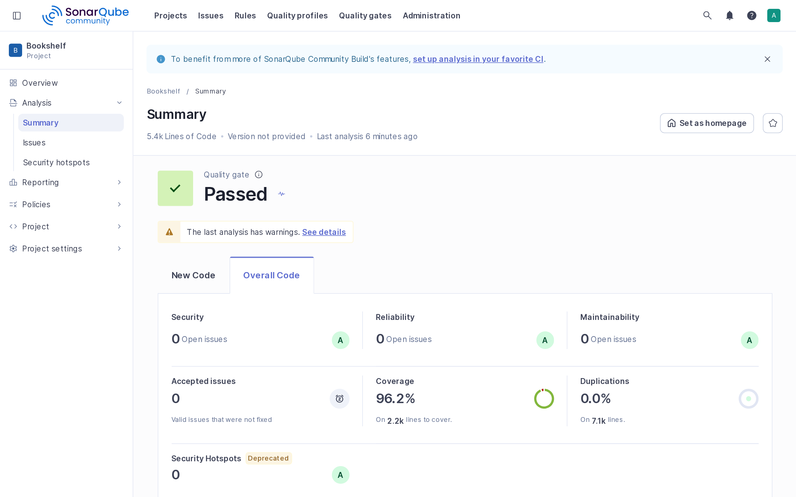
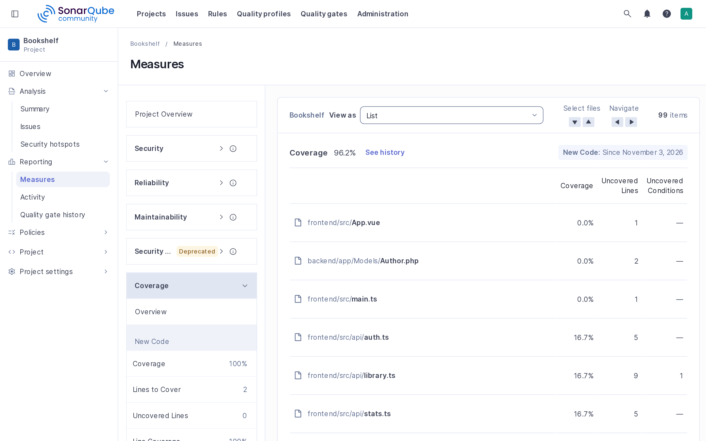

# Звіт про якість коду (SonarQube)

Проєкт: Bookshelf (Laravel API + Vue 3 PWA). Інструмент: SonarQube Community Build, локальний екземпляр.
Налаштування та запуск описані в [`sonar.md`](sonar.md). Показники нижче взято з останнього аналізу.

> Note: this report and its screenshots were made on the standalone version of the project before the features were merged. Run `make sonar` and refresh the figures and screenshots before submitting.

**Quality Gate: Passed.**

## Оцінки якості

| Показник | Значення | Оцінка |
|---|---|---|
| Security (безпека) | 0 проблем | **A** |
| Reliability (надійність) | 0 проблем | **A** |
| Maintainability (підтримуваність) | 0 проблем | **A** |
| Технічний борг | 0 хв | |

## Проблеми

| Показник | Значення |
|---|---|
| Bugs | 0 |
| Vulnerabilities | 0 |
| Security hotspots | 0 |
| Code smells | 0 |
| Відкриті issues | 0 |
| Позначено як False Positive | 1 (`autocomplete="name"` у `RegisterView.vue`) |

## Покриття тестами

| Показник | Значення |
|---|---|
| Загальне покриття | **96,2 %** |
| Покриття рядків | 97,5 % |
| Покриття умов (гілок) | 92,8 % |
| Рядків до покриття | 2 158 |
| Непокритих рядків | 53 |
| Backend (Pest) | 98,4 % операторів |
| Frontend (Vitest) | 96,4 % рядків |

## Розмір і складність

| Показник | Значення |
|---|---|
| Рядків коду (ncloc) | 5 425 |
| Файлів | 107 |
| Функцій | 421 |
| Класів | 50 |
| Цикломатична складність | 746 |
| Когнітивна складність | 404 |
| Коментарі | 6,2 % |
| Дублювання | 0,0 % (0 блоків) |

Мови (рядків коду): PHP 1 629, TypeScript 1 309, JS (скрипти Vue) 2 435, CSS 52.

## Тести

| Набір | Результат |
|---|---|
| Backend, Pest | 281 тест, 809 assertions, усі проходять |
| Frontend, Vitest | 344 тести у 29 файлах, усі проходять |
| Pint, Larastan, ESLint, vue-tsc | без зауважень |

## Що змінилось після першого аналізу

| | Було | Стало |
|---|---|---|
| Vulnerabilities | 1 | 0 |
| Code smells | 2 | 0 |
| Покриття | 91,8 % | 96,2 % |
| Frontend, покриття рядків | 90,2 % | 96,4 % |
| Тестів | 607 | 625 |

Що було виправлено:

- `OpenLibraryClient.php`: ключ кешу тепер рахується через `sha256` замість `sha1` (Vulnerability).
- `QuoteShareView.vue`: роль `img` і підпис перенесені з `canvas` на обгортку (доступність).
- `RegisterView.vue`: зауваження про `autocomplete` позначене як False Positive, бо `autocomplete="name"` є валідним
  значенням за стандартом HTML і потрапляє на справжній `<input>` усередині `FormField.vue`.
- Додано тести для `RegisterView`, `ProfileView`, захисту маршрутів і скидання пароля (`ResetUserPassword`).

## Скріншоти

| Файл | Що показує |
|---|---|
| [01-overview-overall.png](sonar-screenshots/01-overview-overall.png) | Головна: Quality Gate, оцінки A/A/A, покриття, дублювання |
| [02-issues.png](sonar-screenshots/02-issues.png) | Список проблем |
| [03-measures-overview.png](sonar-screenshots/03-measures-overview.png) | Усі міри разом |
| [04-coverage.png](sonar-screenshots/04-coverage.png) | Покриття по файлах |
| [05-size.png](sonar-screenshots/05-size.png) | Розмір коду |
| [06-complexity.png](sonar-screenshots/06-complexity.png) | Складність |
| [07-duplications.png](sonar-screenshots/07-duplications.png) | Дублювання |
| [08-code.png](sonar-screenshots/08-code.png) | Дерево коду проєкту |
| [09-hotspots.png](sonar-screenshots/09-hotspots.png) | Security hotspots |
| [10-activity.png](sonar-screenshots/10-activity.png) | Історія аналізів |





## Як відтворити

```bash
make sonar-up
SONAR_TOKEN=<токен> make sonar
```

Дашборд: <http://localhost:9002/dashboard?id=bookshelf>.

## Обмеження цих показників

- Покриття показує, які рядки виконуються тестами, а не якість самих тестів.
- Точки входу (`main.ts`, `App.vue`) мають 0 % покриття, бо тести їх не запускають.
- Нуль code smells досягнуто виправленнями коду та однією позначкою False Positive.
